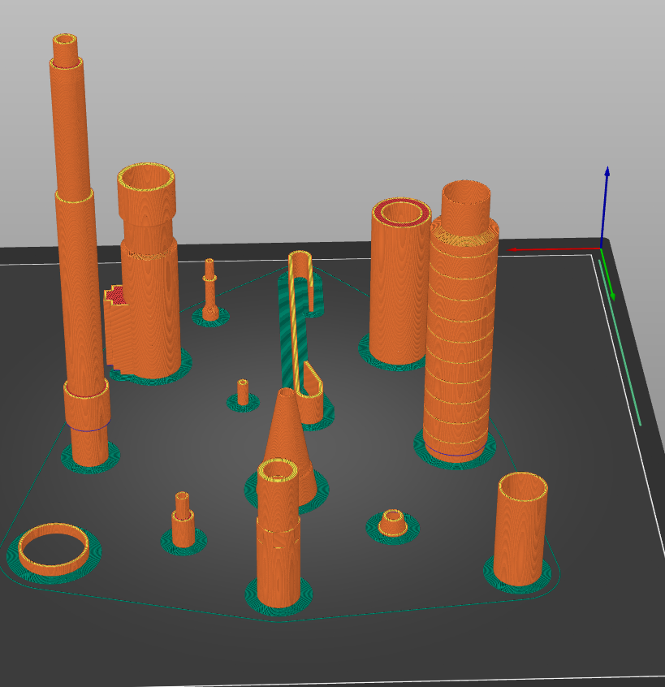

# Mecha-Pencil
hey! This is a simple CAD model of a mechanical pencil. I modelled every part myself and then scaled the project up to 3D print. It is an enthusiast piece meaning so far I have not tested if the model works as intended when printed/
here's a final image of my project:

)

## HOW THIS WAS MADE
this project was made with Fusion 360 though any CAD software will work. I began by looking online for engineering drawings (if that's what you call them) of mechanical pencils. A lot were hard to find but I worked out the measurements I needed. Each part was made in CAD and finally assembled (each STL file is available per part + spring needed). Most builds used the revolve and hole features and sometimes just cylinders. There are 15 parts in total to assemble this pencil. 

Here is the cross section (the spring should be in place):

## heres how to print it out:

Test out tolerences for each piece per printer to make sure things fit (e.g. lead_guide and main_cone)
Drag your files into your preferred slicer (cura, prusasliser)
To make it function you will also need a spring close to 8mm in diameter
The specific lead that will work is unknown but coming soon!
Some parts might need to be superglued.

What printing might look like (really old printer selected):

## AI DISCLOSURE
Used AI for research on how to make a simple and "hopefully" functional pencil. (I did not use its designs for my CAD, only parts needed + searching drawings online)
